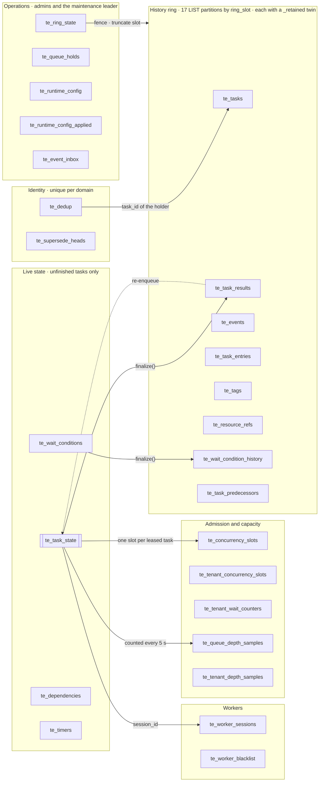

# Task Engine Database

A guide to the Task Engine's storage: which tables exist, how rows move between them, which tables each request and background loop touches, and the rules an implementation must keep. It is drawn from the draft reference DDL in [`migration.sql`](migration.sql) (PostgreSQL form) and the algorithms in [DESIGN.md](DESIGN.md) §3.7 and §4.6, with the decisions of the Task Engine gap review. The gear's own migrations stay authoritative; this file and `migration.sql` describe the target layout.

> **Status: draft.** Builds on the design proposals in #5730, taken as accepted. Section [Verified behaviour](#verified-behaviour) records load probes run against this DDL on PostgreSQL 18.

## At a glance

- **One database per task domain**, all with the same schema (DESIGN §3.8).
- **34 tables** per domain, **56 secondary indexes**.
- **8 ring tables**, each LIST-partitioned by `ring_slot` into **17 partitions**, each with an unpartitioned `_retained` twin (ADR-0009).
- **No foreign keys** between task tables. Rows that refer to a task are written and removed in that task's transactions; reconciliation reports orphans (`te_orphan_rows_total`).
- **Small codes, not enums**: states, kinds and dimensions are `SMALLINT` codes listed at the top of `migration.sql`, so the same DDL works on PostgreSQL, MySQL and SQLite.

## Where the tables sit

Tables group by how long their rows live: a small set of live tables for unfinished tasks, a partitioned history ring for everything a task leaves behind, and counters and operational tables around them. Inside a group, tables share the task key (`task_id`) unless noted.

`finalize()` moves a task from the live tables into the ring in one transaction; retention later truncates whole ring partitions instead of deleting rows. Claims also read `te_queue_holds` through a node cache, and every state change writes `te_events` in the same transaction.

## Query flows

Each flow is one request or background loop, with the tables it touches in order. **BEGIN** and **COMMIT** rows mark transaction boundaries; *italic* steps happen outside the database.

| Access | Meaning |
|---|---|
| `R` | read |
| `W` | insert or update |
| `L` | row lock or guarded update |
| `D` | delete |
| `M` | move to another table |
| `T` | truncate a partition |

### Create a task

`POST /tasks` · One transaction after the PDP check; depth is checked after dedup so a replay is never refused as full.

| # | Tables | Access | What happens |
|---|---|---|---|
|  |  |  | *Authorize with the PDP · resolve the type from cache* |
|  | **BEGIN** |  |  |
| 1 | `te_dedup` | `W` | Insert the key; a conflict is a 409 replay, or an expired row is taken over |
| 2 | `te_supersede_heads` | `L` `W` | p2 · latest order per supersede group |
| 3 | `te_queue_depth_samples`, `te_tenant_depth_samples` | `R` | Sampled depth, read from the node snapshot |
| 4 | `te_tasks` | `W` | Immutable row in the current ring slot |
| 5 | `te_task_state` | `W` | Live row: queued, scheduled, blocked or waiting |
| 6 | `te_tags`, `te_resource_refs` | `W` | Labels and resource references |
| 7 | `te_dependencies`, `te_task_predecessors` | `W` | p2 · live edges, plus the immutable copy for search |
| 8 | `te_wait_conditions` | `W` | Optional initial wait group |
| 9 | `te_timers` | `W` | Queue timeout, scheduled, lifetime, SLA, wait |
| 10 | `te_events` | `W` | taskCreated, plus the outbox row |
|  | **COMMIT** |  |  |

### Claim work

`POST /tasks/claim` · Plan first without locks, then reserve counters in key order before touching any task row.

| # | Tables | Access | What happens |
|---|---|---|---|
|  |  |  | *Node caches: held queues, saturated scopes, rotation cursor* |
| 1 | `te_task_state` | `R` | Critical probe and rotation through the dispatch indexes |
| 2 | `te_concurrency_slots`, `te_tenant_concurrency_slots` | `R` | Plain read of free slots |
|  | **BEGIN** |  |  |
| 3 | `te_concurrency_slots`, `te_tenant_concurrency_slots` | `L` `W` | Reserve slots in canonical key order |
| 4 | `te_task_state` | `L` `W` | Take picks with SKIP LOCKED; set lease, attempt and execution deadline |
| 5 | `te_timers` | `D` | Drop each queue-timeout timer |
| 6 | `te_events` | `W` | taskClaimed, plus the outbox row |
| 7 | `te_worker_sessions` | `W` | Open or renew the session, last |
|  | **COMMIT** |  |  |

### Heartbeat

`POST /tasks/heartbeat` · One row per worker process; the task rows are only read.

| # | Tables | Access | What happens |
|---|---|---|---|
| 1 | `te_worker_sessions` | `W` | One guarded update renews every lease of the process |
| 2 | `te_task_state` | `R` | Check each listed lease; nothing is written |

### Complete and finalize

`POST /tasks/{id}/complete` · Every terminal transition goes through finalize(); large cascades continue from a cascade timer.

| # | Tables | Access | What happens |
|---|---|---|---|
|  | **BEGIN** |  |  |
| 1 | `te_task_state` | `L` `W` | Fenced on lease token, holder and state |
| 2 | `te_ring_state` | `R` | Fence row, only for a task of an old bucket |
| 3 | `te_task_results` | `W` | Terminal row with state and result |
| 4 | `te_task_state` | `D` | Live row removed |
| 5 | `te_concurrency_slots`, `te_tenant_concurrency_slots` | `W` | Release the recorded shards |
| 6 | `te_timers` | `D` | Every timer except a cascade |
| 7 | `te_dedup` | `W` | Set expires_at for the key window |
| 8 | `te_wait_conditions`, `te_wait_condition_history` | `M` | Conditions move to the ring |
| 9 | `te_dependencies` | `W` | Successors’ outcomes; edges copied into the result row |
| 10 | `te_events` | `W` | taskCompleted, plus the outbox row |
|  | **COMMIT** |  |  |

### Timer fires

`Timer loop · per bg_slot shard` · Each node claims due timers in its shards; a stale timer is dropped.

| # | Tables | Access | What happens |
|---|---|---|---|
| 1 | `te_timers` | `L` `W` | Claim due rows by status, fires_at and bg_slot |
| 2 | `te_task_state` | `R` | Stale check against expected_state |
| 3 | `te_task_state` | `W` | Act: scheduled to queued, queue or lifetime timeout to finalize |
| 4 | `te_wait_conditions` | `W` | Wait timer: resolve due conditions |
| 5 | `te_timers` | `W` | Mark done, or re-arm the wait timer at the next deadline |

### Session expiry

`Session scan` · A session that stops heartbeating takes all of its tasks with it.

| # | Tables | Access | What happens |
|---|---|---|---|
| 1 | `te_worker_sessions` | `L` `W` | Mark expired where lease_until has passed |
| 2 | `te_task_state` | `L` `W` | By session_id, in batches: requeue with backoff, or end timed_out |
| 3 | `te_concurrency_slots`, `te_tenant_concurrency_slots` | `W` | Release slots |
| 4 | `te_worker_blacklist` | `W` | One strike per worker and queue |
| 5 | `te_events` | `W` | taskRetrying with cause liveness |

### Depth sampling

`Maintenance leader · every 5 s` · Depth limits are checked against these samples, never a locked counter.

| # | Tables | Access | What happens |
|---|---|---|---|
| 1 | `te_task_state` | `R` | Count queued and deferred tasks per queue, tenant and domain |
| 2 | `te_task_results` | `R` | Dead-lettered counts per dead-letter queue |
| 3 | `te_queue_depth_samples`, `te_tenant_depth_samples` | `W` | Upsert; tenant rows only at or above their limit |
|  |  |  | *Every node polls the samples into its admission snapshot* |

### Retention recycle

`Maintenance leader · per domain` · Retention truncates one partition per bucket instead of deleting rows.

| # | Tables | Access | What happens |
|---|---|---|---|
| 1 | `te_ring_state` | `L` `W` | Mark slot s recycling |
| 2 | `te_task_state` | `W` | Force-cancel live tasks past hard_retention_days, via finalize() |
| 3 | `te_*_retained` | `W` | Rescue rows of slot s that must outlive it |
| 4 | `history ring` | `T` | Truncate partition s of the 8 ring tables |
| 5 | `te_ring_state` | `W` | Slot s active again, for bucket B + N |
| 6 | `te_dedup`, `te_supersede_heads` | `D` | Expired keys and removed group heads |

### Search tasks

`GET /tasks` · Per domain, live and terminal tasks are read separately and merged by the cursor.

| # | Tables | Access | What happens |
|---|---|---|---|
| 1 | `te_task_state` | `R` | Live tasks: tenant_state and tenant_id indexes |
| 2 | `te_task_results` | `R` | Terminal tasks inside the created_at window (and _retained) |
| 3 | `te_tags`, `te_resource_refs` | `R` | has_tag() and has_resource_ref() semi-joins |
| 4 | `te_dependencies`, `te_task_predecessors` | `R` | predecessor_id filter |
| 5 | `te_tasks` | `R` | Input and type for view=full |
|  |  |  | *Merge across domains by cursor* |

## Rules the implementation must keep

These rules carry the correctness of the design. Each links to its source; the [Verified behaviour](#verified-behaviour) section shows what breaks without the ones that were probed.

1. **One lock order, counters first.** Every transaction takes row locks in this order: `te_concurrency_slots` (1), `te_tenant_concurrency_slots` (2), `te_tenant_wait_counters` (3), then `te_task_state` rows (ascending `task_id`, or parent before child), and `te_worker_sessions` last (DESIGN §3.7 Lock ordering, ADR-0008; the proposals removed `te_dependency_locks` and `te_tenant_queue_backlog`).
2. **Plan, then counters, then transition.** Read the tasks without a lock, apply the counter deltas in lock order with guarded updates, then run each task transition as an update guarded on the expected state. A guard that matches nothing rolls the transaction back (single task) or skips and redoes the task (bulk).
3. **Claims never use locking reads.** They pick with `FOR UPDATE SKIP LOCKED` and decide with guarded updates.
4. **Releases decrement the recorded shard.** A reservation stores the shard it took on the task row (`queue_slot_shard`, `type_slot_shard`, `tenant_queue_slot_shard`, `tenant_type_slot_shard`); the release decrements exactly that shard.
5. **Counter reconciliation is lock, then count, in two statements.** Per counter row, in its own short transaction: lock the counter row (`FOR UPDATE`), then count the live holders in a **separate, later statement**, then write if different (DESIGN §3.7 Counter reconciliation). Counting first, or one `UPDATE … SET used = (SELECT count(*) …)`, loses concurrent changes and lets a shard admit beyond its limit ([probe 1](#probe-1-concurrency-counters)). On MySQL and MariaDB the transaction runs at `READ COMMITTED`.
6. **Old-bucket writes go through the ring fence.** A transaction that writes a history row for a task of bucket `b ≤ c + 2 − N` first locks that slot's `te_ring_state` row; if the slot is not `active` for `b`, the row goes to the `_retained` twin (DESIGN §3.7 Ring fence). Newer tasks skip the check.
7. **Truncate a slot without stalling readers** ([probe 2](#probe-2-ring-fence-and-truncation)):
   - run `TRUNCATE` with a short `lock_timeout` (about 50 ms), retry with backoff and jitter, and cap the attempts per maintenance run (the next run continues);
   - before each attempt, skip it while another session holds a lock on the partition (`pg_locks`), so the attempt does not queue behind a long reader;
   - give queries that span ring slots (queue history, searches over `te_task_results`, `te_tags`, `te_resource_refs`) a `statement_timeout`, so no reader holds a slot for long;
   - keep reads on custom plans (`plan_cache_mode = force_custom_plan` on the gear's connections), because a generic plan locks all 17 partitions of the table.
8. **No runtime partition DDL.** The partitions are created once by the migrations; retention only truncates (ADR-0009).

## Verified behaviour

Load probes against this DDL on PostgreSQL 18 (Docker `postgres:18-alpine`, 14 CPUs), run on 2026-11-09.

### Probe 1: concurrency counters

**Question.** Do the sharded counters stay exact under concurrent claims, completions and requeues, and is the reconciliation safe to run during that load?

**Setup.** One queue, 4 tenants. `queue_global` limit 256 in 8 shards of 32; `queue_tenant` limit 96 per tenant in 3 shards of 32, so both dimensions bind. 100,000 queued tasks. 16 clients: claim (60%), complete (30%), requeue (10%); complete and requeue pick among the oldest leased tasks, so they race for the same rows. Reconciliation runs one full pass (20 counter rows, one transaction each) every 50 ms. A checker compares every counter with its live holders in one snapshot every 20 ms. 30 s per run.

| Reconciliation | Throughput | Corrections | Checker: over limit | End state |
|---|---|---|---|---|
| **Lock, then count in a new statement (DESIGN)** | 8,751 tx/s | **0** of 9,160 row passes | **0** of 1,291 snapshots | exact (256 = 256) |
| Count, then lock and write | 7,954 tx/s | 3,109 spurious | 596 snapshots, up to +4 | drifted |
| One `UPDATE … SET used = (SELECT count(*) …)` | 8,053 tx/s | 2,614 spurious | 973 snapshots, up to +4 | drifted |
| DESIGN, with 40 injected ±3 errors | 8,432 tx/s | 31, each exactly ±3 | 11 snapshots, until the next pass | exact |

- No deadlocks in any run. About 51,000 lost races between complete and requeue all rolled back through the expected-state guard.
- The one-statement form is wrong because the subquery's snapshot is taken before the statement waits for the counter row, so a change that commits during the wait is overwritten. It is also the form an ORM produces most naturally, which is why rule 5 names it.
- Downward drift (only from a bug or a manual edit) lets a shard admit beyond its limit until the next pass, so the exposure is one `slot_reconcile_interval_secs`.

### Probe 2: ring fence and truncation

**Question.** Can a slot be recycled while the engine keeps writing and reading, without losing a committed row and without stalling traffic?

**Setup.** `te_events` with 100,000 rows in each of the 17 slots. Concurrent for 20 s: 4 clients inserting into the current slot, 2 clients writing events for 200 live tasks of the old bucket through the ring fence, 2 clients each of point reads by `(id, ring_slot)` on generic and on custom plans, 2 clients reading queue history across all slots. At 5 s a slow reader holds the old slot for 4 s; at 6 s retention marks the slot, rescues the live tasks' rows into `te_events_retained`, truncates and reactivates it.

| Check | Result |
|---|---|
| Old-bucket writes committed during the cycle | ~16,000 (~4,800 to the ring before the mark, the rest to `_retained`) |
| Committed writes missing afterwards | **0** |
| Writes to the ring after the mark | **0** |
| Rows left in the recycled slot | **0** |
| Live tasks' rows rescued | 1,000 of 1,000 |

Latency in ms; "worst in cycle" covers mark to reactivation.

| Workload | p50 | p99 | Worst in cycle, `lock_timeout` 200 ms | Worst in cycle, no lock timeout |
|---|---|---|---|---|
| Insert into the current slot | 0.31 | 0.47 | 3.7 | 3.4 |
| Fenced old-bucket write | 2.48 | 2.91 | 5.9 | 5.5 |
| Point read, generic plan | 0.06 | 0.13 | 201 | 2,947 |
| Point read, custom plan | 0.09 | 0.16 | 201 (reads of the old slot only) | 2,946 |
| Queue history, all slots | 0.23 | 0.35 | 201 | 2,947 |

With the partition locked, a direct check shows which statements wait:

| Statement against slot 3, while slot 9 is locked | Waits? |
|---|---|
| Point read with a literal `ring_slot`, or a prepared read on a custom plan | no |
| Prepared read on a **generic** plan | **yes**: a generic plan locks every partition |
| Insert through the parent (literal or prepared) | no: rows are routed lazily |
| Read without a `ring_slot` filter (for example by `queue_id`) | **yes** |
| `UNION ALL` of the ring slot and its `_retained` twin | no |

- The fence works: no write lands in a slot after it is marked, and nothing committed is lost.
- Writers never stall. Readers stall because a waiting `TRUNCATE` queues an exclusive lock on the partition, and every later reader of that partition queues behind it until the slow reader ends. Without a lock timeout the stall lasts as long as the slowest reader; with a 200 ms timeout each retry stalls readers for up to 200 ms (10 retries in this run). Rule 7 bounds both.
- PostgreSQL's default `plan_cache_mode = auto` chose custom plans for the point read (8 of 8 executions), so the generic-plan stall needs a plan switch to happen; pinning custom plans removes the risk.
- An alternative is `DETACH PARTITION … CONCURRENTLY`, truncate, then `ATTACH`. It does not stall readers, but it is runtime partition DDL, which ADR-0009 rules out.

### Not covered yet

- MySQL and MariaDB: `ALTER TABLE … TRUNCATE PARTITION` takes a metadata lock on the whole table rather than one partition, so its effect on readers and writers is likely larger and needs its own probe.
- Type dimensions, the wait counters, and shard-count changes (draining shards). They use the same mechanism as the probed counters.
- Ring tables other than `te_events`. The lock behaviour is per partition, so it is the same.

## Table directory

Every table with its primary key and secondary indexes, generated from the PostgreSQL catalog after applying `migration.sql`. Ring tables carry `ring_slot` in the key; their `_retained` twins have the same columns, keyed without it.

### Live state

Non-terminal tasks only; small and hot. Rows leave through finalize().

| Table | Holds | Primary key | Indexes |
|---|---|---|---|
| `te_task_state` | Authoritative state, queue, urgency, priority, lease and deadlines of every live task | `task_id` | `task_state_assignment_deadline` (assignment_deadline, bg_slot) WHERE (state_code = 4) `task_state_execution_deadline` (execution_deadline, bg_slot) WHERE (execution_deadline IS NOT NULL) `task_state_handoff` (handoff_until, bg_slot) WHERE (handoff_until IS NOT NULL) `task_state_parent` (parent_task_id, task_id) WHERE (parent_task_id IS NOT NULL) `task_state_queue_dispatch` (queue_id, state_code, urgency_code, priority, created_at, task_id) `task_state_session` (session_id) WHERE (session_id IS NOT NULL) `task_state_tenant_dispatch` (queue_id, state_code, urgency_code, owner_tenant_id, priority, created_at, task_id) `task_state_tenant_id` (owner_tenant_id, task_id) `task_state_tenant_state` (owner_tenant_id, state_code, task_id) |
| `te_wait_conditions` | Wait conditions of live tasks: the current group and earlier, replaced ones | `id` | `waits_children_pending` (parked_at) WHERE ((kind_code = 3) AND (state_code = 1)) `waits_event_subject` (event_type, owner_tenant_id, event_subject_id) WHERE ((kind_code = 4) AND (state_code = 1)) `waits_resume` (timer_resume_at) WHERE ((kind_code = 1) AND (state_code = 1)) `waits_task` (task_id, created_at, id) `waits_timeout` (timeout_at) WHERE (state_code = 1) |
| `te_dependencies` | Predecessor edges while the successor is live, with each edge’s outcome | `task_id, predecessor_id` | `deps_predecessor` (owner_tenant_id, predecessor_id, task_id) |
| `te_timers` | Durable deadlines: queue, scheduled, lifetime, SLA, wait, cancel grace, cascade | `id` | `timers_claim_until` (claim_until) WHERE (status_code = 2) `timers_pending_fires` (status_code, fires_at, bg_slot) `timers_task` (task_id, timer_type_code) |

### History ring

LIST-partitioned by ring_slot into 17 slots; each has an unpartitioned _retained twin for rows that outlive their slot.

| Table | Holds | Primary key | Indexes |
|---|---|---|---|
| `te_tasks` (ring) | Immutable data written once at create: type, input, effective settings, authority | `id, ring_slot` | `tasks_parent` (parent_task_id, id) WHERE (parent_task_id IS NOT NULL) |
| `te_task_results` (ring) | Terminal tasks: state, result, output, error; moved back by re-enqueue | `task_id, ring_slot` | `task_results_dlq` (queue_id, task_id) WHERE (state_code = 10) `task_results_tenant_dlq_from` (owner_tenant_id, dead_lettered_from, task_id) WHERE (state_code = 10) `task_results_tenant_id` (owner_tenant_id, task_id) `task_results_tenant_queue` (owner_tenant_id, queue_id, task_id) `task_results_tenant_state` (owner_tenant_id, state_code, task_id) `task_results_tenant_terminal` (owner_tenant_id, state_code, terminal_at, task_id) `task_results_tenant_type` (owner_tenant_id, type_id, task_id) `task_results_terminal` (terminal_at) |
| `te_events` (ring) | Task history, written in every state-change transaction; the published event id | `id, ring_slot` | `events_queue` (queue_id, id) WHERE (queue_id IS NOT NULL) `events_task` (task_id, id) WHERE (task_id IS NOT NULL) |
| `te_task_entries` (ring) | Immutable entries from the worker or an API consumer | `id, ring_slot` | `entries_task` (task_id, created_at, id) |
| `te_tags` (ring) | Labels for the has_tag() filter | `task_id, tag_key, ring_slot` | `tags_key_value` (owner_tenant_id, tag_key, tag_value, task_id) |
| `te_resource_refs` (ring) | Platform resources a task works on, for has_resource_ref() | `task_id, resource_type_id, resource_id, ring_slot` | `resource_refs_lookup` (owner_tenant_id, resource_type_id, resource_id, task_id) |
| `te_wait_condition_history` (ring) | Wait conditions of terminal tasks | `id, ring_slot` | `wait_history_task` (task_id, created_at, id) |
| `te_task_predecessors` (ring) | Immutable predecessor edges for the predecessor_id filter | `task_id, predecessor_id, ring_slot` | `task_predecessors_pred` (owner_tenant_id, predecessor_id, task_id) |

### Admission and capacity

Exact concurrency counters are locked in claims; depth limits use samples.

| Table | Holds | Primary key | Indexes |
|---|---|---|---|
| `te_concurrency_slots` | Queue-wide and type-wide concurrency, sharded; lock order 1 | `dimension_code, scope_id, shard` | PK only |
| `te_tenant_concurrency_slots` | Per-tenant concurrency per queue and type; lock order 2 | `owner_tenant_id, dimension_code, scope_id, shard` | PK only |
| `te_tenant_wait_counters` | Pending event-wait conditions per tenant; lock order 3 | `owner_tenant_id, dimension_code, scope_id` | PK only |
| `te_queue_depth_samples` | Sampled task counts per queue and state | `queue_id, state_code` | PK only |
| `te_tenant_depth_samples` | Tenant keys whose sampled count is at or above the limit | `owner_tenant_id, dimension_code, queue_id` | `tenant_depth_samples_sampled` (sampled_at) |

### Identity

Unpartitioned, so the uniqueness check is global within the domain.

| Table | Holds | Primary key | Indexes |
|---|---|---|---|
| `te_dedup` | Occupied creation identities: derived dedup keys and caller idempotency keys | `owner_tenant_id, dedup_key` | `dedup_expires` (expires_at) WHERE (expires_at IS NOT NULL) `dedup_task` (task_id) |
| `te_supersede_heads` | Latest order per supersede group (p2) | `owner_tenant_id, group_key` | `supersede_heads_created` (latest_created_at) |

### Workers

Written by claims, heartbeats and the session scan.

| Table | Holds | Primary key | Indexes |
|---|---|---|---|
| `te_worker_sessions` | One row per worker process and domain; heartbeats write only this | `session_id` | `sessions_expiry` (status_code, lease_until, bg_slot) |
| `te_worker_blacklist` | Consecutive worker-attributed failures per worker and queue | `worker_subject, worker_id, queue_id` | `worker_blacklist_until` (blacklisted_until) WHERE (blacklisted_until IS NOT NULL) `worker_blacklist_updated` (updated_at) |

### Operations

Engine-wide state kept by admins and the maintenance leader.

| Table | Holds | Primary key | Indexes |
|---|---|---|---|
| `te_ring_state` | One row per ring slot: the fence between old-bucket writers and retention | `ring_slot` | PK only |
| `te_queue_holds` | Held queues; nodes cache them and skip their tasks in claims | `queue_id` | `queue_holds_until` (hold_until) WHERE (hold_until IS NOT NULL) |
| `te_runtime_config` | Saved runtime config versions (default domain only) | `config_version` | PK only |
| `te_runtime_config_applied` | The version this domain has applied | `singleton` | PK only |
| `te_event_inbox` | Inbound broker events already applied, for event waits | `event_id` | `event_inbox_received` (received_at) |

## Implementation notes

To take into account when the gear's migrations and queries are written:

- **Per-table autovacuum settings** on the hot, update-heavy tables: `te_task_state`, `te_timers`, `te_worker_sessions` and the counter tables (`te_concurrency_slots`, `te_tenant_concurrency_slots`, `te_tenant_wait_counters`).
- **Documented `ORDER BY` choices** in sweep queries (timers, deadlines, session expiry, retention), so the planner stays on the intended partial index.
